## 1. Tóm tắt cấp cao (TL;DR)

*   **Ảnh hưởng**: **Trung bình** - Lần thay đổi này chủ yếu liên quan đến tối ưu logic nghiệp vụ backend, tăng cường xử lý ngoại lệ Session, và frontend chuyển từ Webpack sang công cụ build Vue CLI.
*   **Thay đổi cốt lõi**:
    *   🔧 **Tối ưu truy vấn nhà sản xuất**: Tái cấu trúc logic xử lý tham số, thêm kiểm tra tham số và bảo vệ giá trị rỗng
    *   💊 **Sửa lỗi kiểm soát tồn kho**: Logic tính tồn kho hỗ trợ bán lẻ tách lẻ
    *   📋 **Liên động trạng thái đơn thuốc**: Khi lưu đơn thuốc, tự động cập nhật trạng thái xét nghiệm - kiểm tra
    *   🛡️ **Session Xử lý ngoại lệ**: Tăng cường khả năng xử lý ngoại lệ của lớp công cụ, ngăn Session hết hạn gây sập hệ thống
    *   📦 **Nâng cấp công cụ build**: Frontend chuyển từ Webpack 3 sang Vue CLI 5

---

## 2. Tổng quan trực quan (Ánh xạ mã và logic)

```mermaid
graph TD
    subgraph "Quản lý nhà sản xuất"
        A["ManufactureFactoryService.listAlls()"]
        B["Kiểm tra tham số<br/>company_id"]
        C["Lọc danh sách tham số"]
        D["DAOTruy vấn"]
        A --> B --> C --> D
    end
    
    subgraph "Kiểm soát tồn kho"
        E["MedicinalStorageControlService<br/>Tồn kho đặt trước"]
        F["Xác định bán lẻ<br/>isUnpackSell"]
        G["Chuyển đổi đơn vị<br/>Đóng gói→Chế phẩm"]
        H["Kiểm tra tồn kho"]
        E --> F --> G --> H
    end
    
    subgraph "Nghiệp vụ đơn thuốc"
        I["RecipelDetailService<br/>Lưu đơn thuốc"]
        J["Cập nhật ngày khám đã đăng ký"]
        K["Lấy danh sách kiểm tra xét nghiệm"]
        L["Cập nhật hàng loạt trạng thái thành đã điền"]
        I --> J --> K --> L
    end
    
    subgraph "SessionLớp công cụ"
        M["SessionUtils"]
        N["getUserJson()"]
        O["getUserDto()"]
        P["setUserJson()"]
        Q["try-catchĐóng gói"]
        M --> N
        M --> O
        M --> P
        N --> Q
        O --> Q
        P --> Q
    end
    
    style A fill:#bbdefb,color:#0d47a1
    style E fill:#fff3e0,color:#e65100
    style I fill:#c8e6c9,color:#1a5e20
    style M fill:#f3e5f5,color:#7b1fa2
```



---

## 3. Phân tích chi tiết thay đổi

### 3.1 Tối ưu logic nghiệp vụ backend

#### 🔧 Dịch vụ truy vấn nhà sản xuất (`ManufactureFactoryService.java`)

**Mô tả thay đổi**:
Đã tái cấu trúc `listAlls` Phương pháp，Đã sửaTham số处理Trong logic của Vấn đề tiềm ẩn。

| Hạng mục thay đổi | Cách triển khai cũ | Cách triển khai mới |
|--------|--------|--------|
| Lọc tham số | Trực tiếp `remove(0)` XóaĐầu tiênCáiTham số | Sử dụng `stream().filter()` Lọc `company_id` |
| Kiểm tra tham số | Không kiểm tra，Gọi trực tiếp `get()` | Sử dụng `isPresent()` Kiểm tra rồi ném ngoại lệ |
| Sửa danh sách gốc | Trực tiếpSửa đổiTruyền vào của  `parameters` | TạoMới của  `filteredParameters` Danh sách |
| Chú thích mã | KhôngChú ýGiải thích | ThêmChi tiết của Phương pháp và bướcChú ýGiải thích |

**Quan trọngMãViênĐoạn**:
```java
// Thêm kiểm tra tham số mới
if (!companyOptional.isPresent()) {
    throw new IllegalArgumentException("Missing required parameter: company_id");
}

// TạoMớiTham sốCộtBảng，TránhMiễnSửa đổiGốcCộtBảng
List<Parameter> filteredParameters = parameters.stream()
        .filter(item -> !item.getColumnName().equals("`company_id`"))
        .collect(Collectors.toList());
```

---

#### 💊 Dịch vụ kiểm soát tồn kho (`MedicinalStorageControlService.java`)

**Mô tả thay đổi**:
Đã sửaTồn khoLogic chiếm trước，ỐngHỗ trợBán lẻ tách lẻ của Tồn khoTính toán。

| Hạng mục thay đổi | Giải thích |
|--------|------|
| Logic chuyển đổi đơn vị | Thêm mới：Khi `isUnpackSell == 0` Giờ，SẽĐơn vị đóng góiChuyển đổi là Đơn vị chế phẩm |
| Công thức chuyển đổi | `total = total × preparation` (Số lượng chế phẩm) |
| Điều chỉnh thời điểm kiểm tra | SẽSố âmvà零Giá trịKiểm tra移到Đơn vịChuyển đổiSau đó |
| Tối ưu chú thích | SẽTrong文Chú ýGiải thíchChuẩn hóa |

**Quan trọngMãViênĐoạn**:
```java
// CâyDữ liệuCó hay khôngBán lẻ tách lẻXác địnhTổng lượngĐơn vị
BigDecimal totalBigDecimal = new BigDecimal(recipelDetail.getTotal());
// Như果不Bán lẻ tách lẻ，total LàĐơn vị đóng gói，CầnChuyển đổi là Đơn vị chế phẩm
if (recipelDetail.getIsUnpackSell() != null && recipelDetail.getIsUnpackSell() == 0) {
    if (drug != null && drug.getPreparation() != null) {
        totalBigDecimal = totalBigDecimal.multiply(new BigDecimal(drug.getPreparation()));
    }
}
```

---

#### 📋 Dịch vụ chi tiết đơn thuốc (`RecipelDetailService.java`)

**Mô tả thay đổi**:
TrongĐơn thuốcLưuSau khi thành công，Tự độngCập nhậtĐóĐơn thuốcDướiTất cảXét nghiệm - kiểm tra của Trạng thái là "Đã điền"。

| Hạng mục thay đổi | Giải thích |
|--------|------|
| Thêm phụ thuộc mới | `InspectionCheckService` |
| Thêm import mới | `InspectionCheck` Thực thểLớp、`CollectionUtils` Lớp công cụ |
| Logic nghiệp vụ | Tại hai nơiĐơn thuốcLưuTrong logicThêmXét nghiệm - kiểm traTrạng tháiCập nhật |

**Quan trọngMãViênĐoạn**:
```java
// Cập nhậtĐóĐơn thuốcDướiTất cảXét nghiệm - kiểm traTrạng thái là Đã điền
List<InspectionCheck> inspectionChecks = inspectionCheckService.getByRecipelInfoId(recipelInfo.getId());
if (!CollectionUtils.isEmpty(inspectionChecks)) {
    for (InspectionCheck inspectionCheck : inspectionChecks) {
        inspectionCheck.setStatus("1");
        inspectionCheckService.save(inspectionCheck);
    }
}
```

---

### 3.2 Session Tăng cường xử lý ngoại lệ cho lớp tiện ích

#### 🛡️ SessionUtils (HaiCáiPhiên bản)

**Mô tả thay đổi**:
 là Tất cả Session Phương pháp liên quanThêm `try-catch` Xử lý ngoại lệ，Ngăn Session Hết hạnHoặc không tồn tạiGiờNémNgoại lệGây ra系统Sập hệ thống。

| Phương pháp | Thay đổiLoại | Chiến lược xử lý ngoại lệ |
|------|----------|--------------|
| `getUserJson()` | Đọc | Bắt ngoại lệ và trả về `null` |
| `getUserDto()` | Đọc | Bắt ngoại lệ và trả về `null` |
| `getUserJson(Session)` | Đọc | Thêm kiểm tra null + Bắt ngoại lệ |
| `setUserJson()` | Ghi | Bắt ngoại lệ và xử lý im lặng |
| `getUserPermission()` | Đọc | Bắt ngoại lệ và trả về `null` |
| `setUserPermission()` | Ghi | Bắt ngoại lệ và xử lý im lặng |
| `getWeChatUser()` | Đọc | Bắt ngoại lệ và trả về `null` |
| `setWeChatUser()` | Ghi | Bắt ngoại lệ và xử lý im lặng |
| `getUser()` | Đọc | Thêm kiểm tra null |
| `setLoginTenantId()` | Ghi | Bắt ngoại lệ và xử lý im lặng |
| `setLoginTenant()` | Ghi | Bắt ngoại lệ và xử lý im lặng |
| `getLoginTenantId()` | Đọc | Bắt ngoại lệ và trả về `null` |
| `getLoginTenant()` | Đọc | Bắt ngoại lệ và trả về `null` |

**Quan trọngMãThể hiệnCa**:
```java
// Phương pháp đọcThể hiệnCa
public static JSONObject getUserJson(){
    try {
        return (JSONObject)SecurityUtils.getSubject().getSession().getAttribute(SESSION_USER_INFO);
    } catch (Exception e) {
        return null;
    }
}

// Phương pháp ghiThể hiệnCa
public static void setUserJson(JSONObject userObj ){
    try {
        SecurityUtils.getSubject().getSession().setAttribute(SESSION_USER_INFO, userObj);
    } catch (Exception e) {
        // Session ĐãHết hạnHoặc không tồn tại
    }
}
```

---

### 3.3 Thay đổi file cấu hình

#### 📝 Cấu hình ứng dụng (`application-demo.yml`)

| Cấu hìnhHạng mục | CũGiá trị | MớiGiá trị | Giải thích |
|--------|------|------|------|
| **Cổng dịch vụ** | `9016` | `7016` | Thay đổi cổng dịch vụ |
| **Cơ sở dữ liệuURL** | `61.172.179.48:19011/medical2.0` | `61.172.179.73:5011/md_yzs20250331` | Cơ sở dữ liệuDi chuyển |
| **Người dùng cơ sở dữ liệu** | `new_touch` | `root` | Người dùngThay đổi |
| **Mật khẩu cơ sở dữ liệu** | `bW9Ivzt0CAQdoJTDZ2wAnduvi` | `xZ_TTSL123` | Mật khẩuCập nhật |
| **RedisMáy chủ** | `61.172.179.48` | `127.0.0.1` | Chuyển sangCuốnMáy cục bộ |
| **RedisCổng** | `19012` | `6379` | DùngMặc địnhCổng |
| **JWTThời gian hết hạn** | `3600000` (1Giờ) | `36000000` (10Giờ) | Kéo dàiPhiênThời gian |
| **Backend báo cáo** | `localhost` | `localhostx` | Cấu hìnhThay đổi |
| **RabbitMQ** | ĐãCấu hình | ĐãChú ýGiải thích | 移除Tin nhắnHàng đợiCấu hình |
| **QixinbaoCấu hình** | ĐãCấu hình | ĐãChú ýGiải thích | Loại bỏ dịch vụ bên thứ ba |
| **WeChat doanh nghiệpCấu hình** | ĐãCấu hình | ĐãChú ýGiải thích | Loại bỏ dịch vụ bên thứ ba |

---

#### 🚫 Git Quy tắc bỏ qua (`.gitignore`)

| Thêm mớiQuy tắc | Giải thích |
|----------|------|
| `.vs/` | Visual Studio Cấu hìnhDanh mục |
| `.trae/` | Trae Công cụCấu hìnhDanh mục |
| `.history/` | TệpLịch sửDanh mục |

---

### 3.4 Nâng cấp công cụ build frontend

#### 📦 Quản lý phụ thuộc (`package.json`)

**Di chuyển công cụ build**: TừTùy chỉnh Webpack Cấu hìnhSang Vue CLI 5

| 构建脚Cuốn | Lệnh cũ | Lệnh mới |
|----------|--------|--------|
| Môi trường phát triển | `webpack-dev-server` | `vue-cli-service serve --no-eslint` |
| Build production | `node build/build.js` | `vue-cli-service build` |
| Kiểm tra mã | Không | `vue-cli-service lint` |
| Kiểm thử đơn vị | `jest` | `vue-cli-service test:unit` |

**Tóm tắt thay đổi phụ thuộc**:

| Loại | Loại bỏ phụ thuộc | Thêm phụ thuộc mới |
|------|----------|----------|
| **Lõi build** | `webpack@3.6.0`, `webpack-dev-server@2.9.1` | `webpack@5.105.4`, `@vue/cli-service@5.0.9` |
| **Babel** | `babel-core@6.x`, `babel-loader@7.x` | `@babel/core@7.29.0`, `@vue/cli-plugin-babel@5.0.9` |
| **Luồng công việc** | `bpmn-js@2.5.1`, `bpmn-js-properties-panel@0.33.1` | (Đã loại bỏ) |
| **Kiểm thử** | `jest@21.2.0`, `nightwatch@0.9.12` | `@vue/cli-plugin-unit-jest@5.0.9` |
| **Kiểm tra mã** | Không | `eslint@10.2.0`, `eslint-plugin-vue@10.8.0` |
| **Khác** | `extract-text-webpack-plugin`, `uglifyjs-webpack-plugin` | `docx@9.6.1` |

---

## 4. Đánh giá ảnh hưởng và rủi ro

### ⚠️ Thay đổi phá vỡ

| Hạng mục thay đổi | Phạm vi ảnh hưởng | Mức độ rủi ro |
|--------|----------|----------|
| **Cấu hình kết nối cơ sở dữ liệu** | Khởi động dịch vụ backend | 🔴 Cao |
| **JWT Hết hạnThời gianKéo dài** | Người dùngPhiênQuản lý | 🟡 Trong |
| **FrontendCông cụ buildDi chuyển** | Build frontendQuy trình | 🟡 Trong |
| **Session Xử lý ngoại lệ** | Tất cảPhụ thuộc Session  của Chức năng | 🟢 Thấp (Cải tiến tích cực) |
| **Logic tính tồn kho** | ThuốcTồn khoKiểm soát | 🟡 Trong |

### 🧪 Đề xuất kiểm thử

#### Kiểm thử backend
1. **Truy vấn nhà sản xuất**: 
   - Kiểm tra thiếu `company_id` Tham sốGiờCó ném ngoại lệ không
   - Kiểm tra lọc tham số có đúng không

2. **Kiểm soát tồn kho**:
   - 测试Bán lẻ tách lẻ (`isUnpackSell = 0`)  của Tồn khoTính toán
   - 测试不Bán lẻ tách lẻ (`isUnpackSell = 1`)  của Tồn khoTính toán
   - Kiểm chứngSố âmvà零Giá trị của Logic kiểm tra

3. **Nghiệp vụ đơn thuốc**:
   - Kiểm chứngĐơn thuốcLưu后Xét nghiệm - kiểm traTrạng tháiCó hay không正确Cập nhật là  "1"
   - 测试KhôngXét nghiệm - kiểm traGiờ của Logic xử lý

4. **Session Xử lý ngoại lệ**:
   - Mô phỏng Session Kịch bản hết hạn，Xác minh có trả về không `null` Chứ không phảiNémNgoại lệ
   - 测试Tất cả Session Phương pháp đọc/ghi của Xử lý ngoại lệ

#### Kiểm thử frontend
1. **Xác minh build**:
   - Chạy `npm run dev` Kiểm chứngPhát triển环境Khởi động
   - Chạy `npm run build` Kiểm chứngSản xuất构建
   - Chạy `npm run lint` Kiểm chứngMã规范

2. **Xác minh chức năng**:
   - Kiểm chứngQuy trình làm việcLiên quanNhómChiếcCó hay khôngBình thường加载
   - Kiểm traThư viện bên thứ ba (echarts, element-ui)  của Tham chiếu

---

## 5. Kết luận

Lần thay đổi nàyChủ yếu tập trung vào **Tối ưu logic nghiệp vụ backend** và **FrontendCông cụ build现代化**：

✅ **Cải tiến tích cực**:
- Tăng cường了 Session Lớp công cụ của Tính robust，NgănNgoại lệGây ra系统Sập hệ thống
- Đã sửaTồn khoTính toánTrong của Bán lẻ tách lẻLogic缺陷
- Tối ưu了Nhà sản xuấtTra cứu của Tham số处理vàKiểm tra
- FrontendCông cụ build升级到 Vue CLI 5，提升Phát triển体验

⚠️ **Lưu ý**:
- Cơ sở dữ liệuCấu hìnhĐãThay đổi，Cần确保MớiCơ sở dữ liệu环境Đã准备就绪
- JWT Hết hạnThời gianKéo dàiđến 10 Giờ，Cần đánh giá ảnh hưởng an toàn
- Build frontendQuy trìnhThay đổi，Phát triển团队CầnCập nhật构建文档